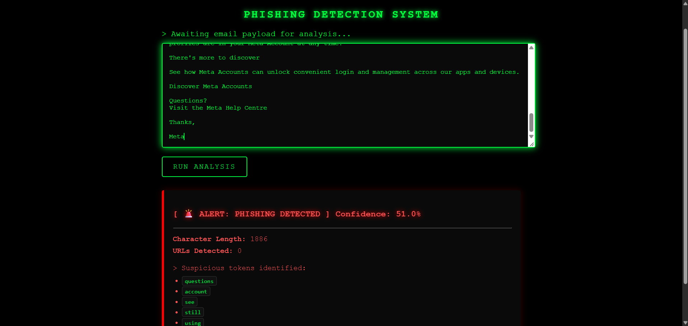
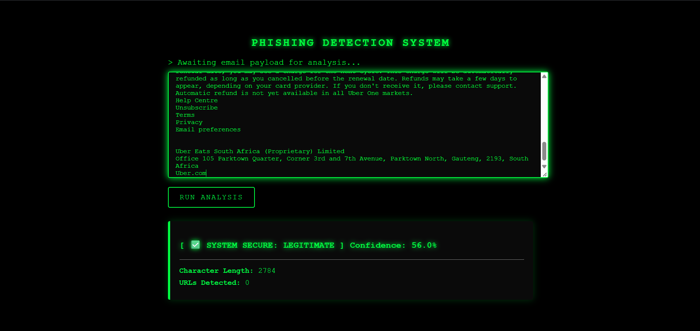

# Intelligent Phishing Detection System

An end-to-end machine learning application that detects phishing emails using Natural Language Processing (NLP) and structural analysis. Built with a focus on **explainability**, the system not only classifies emails but also shows *why* an email was flagged as suspicious.

---

## Overview

Phishing remains one of the most common cybersecurity threats. This project goes beyond a standard Jupyter Notebook experiment to deliver a complete, production-style pipeline. It:

1. Processes raw email text
2. Extracts linguistic and structural features
3. Compares multiple traditional ML models
4. Serves the best-performing model through a custom-styled Flask web application

---

## Repository Structure

```text
intelligent-phishing-detection-system/
│
├── app/
│   ├── app.py                  # Flask backend
│   └── templates/
│       └── index.html          # Matrix-themed frontend
│
├── data/
│   ├── raw/                    # Original dataset (ignored by Git)
│   └── processed/              # Cleaned dataset
│
├── models/                     # Saved .pkl model and vectorizer files
│
├── notebooks/
│   ├── 01_data_exploration.ipynb
│   ├── 02_preprocessing_and_models.ipynb
│   
│
├── screenshots/                # UI screenshots for README
│   ├── phishing_alert.png
│   └── safe_email.png
│
├── requirements.txt
└── README.md
```

---

## Dataset & Preprocessing

The model was trained on the public **Phishing Email Dataset** available on Kaggle (containing a mix of Enron emails, Nazario phishing emails, and SpamAssassin). 
* **Dataset Link:** [Kaggle - Phishing Email Dataset](https://www.kaggle.com/datasets/naserabdullahalam/phishing-email-dataset)
* **Size:** **82,486 emails** (42,891 phishing / 39,595 legitimate).
* **Data Cleaning:** Removed 408 exact duplicate texts to prevent data leakage.
* **Train/Test Split:** 80% Training / 20% Testing (Stratified to maintain class balance).
* **Feature Engineering:** Extracted **5,002 features** per email:
  * **5,000 TF-IDF features:** The top 5,000 most predictive words (excluding English stop words).
  * **2 Structural features:** Character length and URL count.
---

## Model Comparison & Results

Multiple models were evaluated to find the best balance of precision and recall. Accuracy alone is not enough for cybersecurity: the goal is to catch phishing emails (**recall**) while minimizing false alarms (**precision**).

| Model                    | Accuracy | Precision (Phishing) | Recall (Phishing) | F1-Score |
|--------------------------|:--------:|:--------------------:|:-----------------:|:--------:|
| Naive Bayes              | 91.77%   | 0.95                 | 0.89              | 0.92     |
| Logistic Regression      | 97.83%   | 0.98                 | 0.98              | 0.98     |
| Random Forest (Baseline) | 98.64%   | 0.99                 | 0.99              | 0.99     |
| **Random Forest (Final)**| 98.09%   | 0.98                 | 0.98              | 0.98     |

---

## Key Findings & Explainability

### 1. The "Enron Cheat" (Dataset Bias)

The baseline Random Forest reached an impressive 98.64% accuracy. However, analyzing its feature importances revealed a flaw: the model was "cheating" by memorizing Enron-specific words (`enron`, `wrote`, `cc`). Because the dataset's legitimate emails came exclusively from the Enron corporate corpus, the model simply learned that *corporate thread jargon = safe*.

**The fix:** These words were added to the TF-IDF `stop_words` list. Accuracy dropped by only 0.55%, but the model became far more robust, relying on genuine spam indicators such as `char_length`, `url_count`, and words like `subject`, `attached`, and `mailing`.

### 2. Application Explainability

Instead of just returning a "Phishing" label, the Flask web app acts as an explainable AI. When an email is flagged, the app cross-references the text with the Random Forest's feature importances and highlights the top suspicious words that pushed the model toward its decision.

---

## Screenshots

### Detecting Suspicious Activity
The system flags an email and extracts the top suspicious tokens that influenced the model's decision.



### Analyzing Legitimate Emails
The system correctly identifies a long-form corporate email as safe.



---

## Technology Stack

| Area                | Tools                                                        |
|---------------------|--------------------------------------------------------------|
| Data processing     | Pandas, NumPy, SciPy                                         |
| Machine learning    | Scikit-Learn (TF-IDF, Naive Bayes, Logistic Regression, Random Forest) |
| Web framework       | Flask, HTML/CSS                                              |
| Model serialization | Joblib                                                       |

---

## How to Run Locally

**1. Clone the repository**

```bash
git clone https://github.com/yourusername/intelligent-phishing-detection-system.git
cd intelligent-phishing-detection-system
```

**2. Set up a virtual environment**

```bash
python -m venv venv

# Windows
venv\Scripts\activate

# Mac/Linux
source venv/bin/activate
```

**3. Install dependencies**

```bash
pip install -r requirements.txt
```

**4. Run the web application**

```bash
cd app
python app.py
```

**5. Open the app** at [http://127.0.0.1:5000](http://127.0.0.1:5000) in your browser.

---

## ⚠️ Limitations & Future Work

- **False positives:** The dataset's legitimate class is heavily skewed toward long corporate emails, so the model occasionally flags short, legitimate modern emails (e.g., account notifications from Meta) as phishing.
- **No subject line:** The dataset contained only email bodies. Future iterations should train on full email headers, including the subject line and sender metadata, to improve accuracy.
- **Deep learning:** Future work could fine-tune a transformer such as DistilBERT and compare it against the traditional Random Forest baseline.

---

> **Disclaimer:** This application is an educational project. Predictions are advisory and should not be used as the sole method of security defense.
